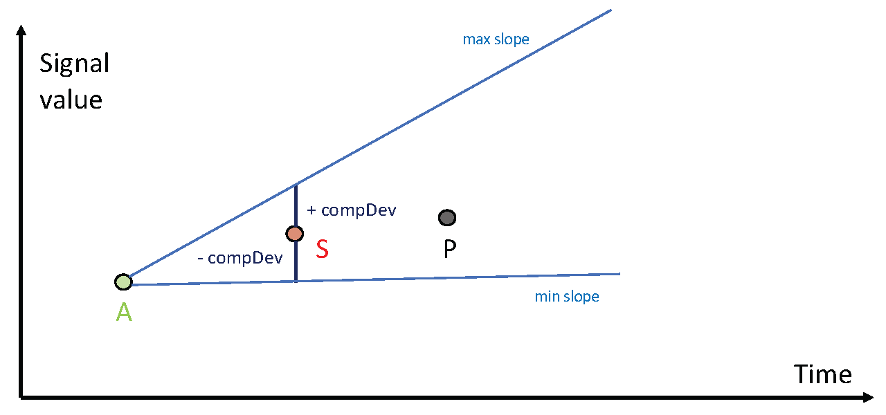
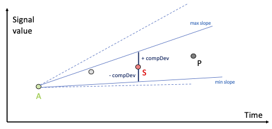
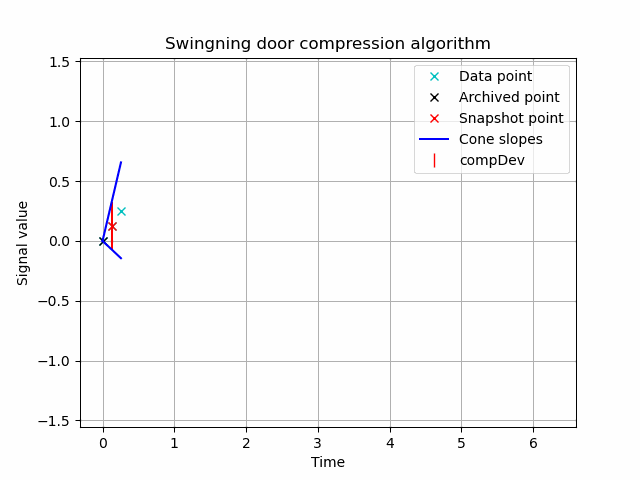

# Downsampler

The downsampler is a Benthos processor that drops messages which add no information to a time
series: exact repeats, changes below a threshold, and values that lie on the trend the previous
points already describe. It runs numeric values through one of two algorithms, deadband (the
default) or swinging door. Boolean and string values go through a change detector instead.

The downsampler removes data by design and keeps all of its state in memory. See
[Delivery guarantees](#delivery-guarantees) for what that means for your pipeline. No setting
makes it lossless. Even with `threshold: 0` and `late_policy: passthrough` it drops exact numeric
repeats, every repeated boolean and string, and every message whose timestamp equals the last
processed timestamp of its series.

## Terms

- **Series**: all messages with the same `umh_topic`. The downsampler keeps its state per series.
- **Emit**: pass a message on to the next stage of the pipeline. A message that is not emitted is
  dropped.
- **Held candidate**: under swinging door, the most recent sample of a series. The downsampler
  keeps it in memory and decides whether to emit it only when the next sample arrives.
- **Heartbeat**: the `max_time` rule. A message that arrives `max_time` or more after the last
  emitted one is emitted, whatever its value.
- **Idle flush**: a background timer that releases the held candidate of a swinging-door series
  that has stopped sending.

## Why a value is missing

If a value you expected is not in your historian, one of these paths dropped it.

1. **Threshold.** This is the intended behaviour. Under deadband, the value was within
   `threshold` of the last emitted value. Under swinging door, the value lay on the trend within
   `threshold`. See [Deadband](#deadband) and [Swinging door](#swinging-door).
2. **Duplicate timestamp.** A message whose `timestamp_ms` equals the last processed timestamp of
   its series is dropped, whatever its value. This is the only cause that is logged above Debug
   level. It is logged at Warn as `Dropping message with duplicate timestamp`.
3. **Boolean or string repeat.** The value is identical to the last emitted value of the same
   type in that series (see [Value types](#value-types)).
4. **`late_policy: drop`.** A numeric message older than the last timestamp of a deadband series
   is dropped. On a swinging-door series it is not dropped. It replaces the held candidate instead
   (see [Late arrivals](#late-arrivals)).
5. **Held candidate discarded.** On a swinging-door series, the held candidate is replaced by each
   newer sample that stays on the trend, which is how swinging door compresses. It is also
   discarded without being emitted when:
   - the heartbeat emits the arriving message (a known defect);
   - a late message passes through under `late_policy: passthrough`;
   - a boolean or string message arrives on the same series;
   - a `ds_*` hint changes the parameters or the algorithm of the series.
6. **Idle flush lost.** If the idle flush runs again before a batch has picked up its previous
   output, the newly released candidates are dropped. This is logged at Warn as
   `Could not flush ... idle candidates - shutdown batch channel full`.
7. **Restart or shutdown.** All state is in memory. A held candidate is lost when the process
   stops, and the points collected at shutdown are never emitted, which is a known defect (see
   [Delivery guarantees](#delivery-guarantees)).

From outside the processor you can only partly tell these causes apart. The counters cover the
whole processor, not a single series, and nothing records which message was dropped. What does
help is the `downsampling_config` and `downsampled_by` metadata on the last point of the series
that reached the historian. It shows the algorithm and the parameters the series actually runs
with (see [Output metadata](#output-metadata)).

## Why a value is emitted anyway

A value reaches your historian even though the configuration would drop it in these cases.

1. **First message of a series.** It is always emitted. That includes the first message after a
   restart, after a `ds_*` hint changes the series (see [Metadata overrides](#metadata-overrides))
   and after an idle flush.
2. **Heartbeat.** The arriving message is emitted because `max_time` has passed (see
   [max_time](#max_time)).
3. **`late_policy: passthrough`, the default.** A numeric message older than the last timestamp
   of its series skips the algorithm and is emitted.
4. **`ds_ignore`.** A message with any non-empty `ds_ignore` value, including `"false"`, skips
   the downsampler.
5. **Error path.** The processor forwards every message it cannot handle unchanged. That includes
   every message of a series whose configuration is invalid (see
   [Startup validation](#startup-validation)) and every raw JSON message (see
   [Which messages are downsampled](#which-messages-are-downsampled)).
6. **Idle flush.** The held candidate of a swinging-door series that has stopped sending is
   released (see [max_time](#max_time)).

## Which messages are downsampled

A message is downsampled only if both of these hold:

- the metadata field `umh_topic` is present;
- the payload is a JSON object with exactly the two keys `timestamp_ms` and `value`.

Every other message, for example one with a third key, without `umh_topic` or with a top-level
array, is forwarded unchanged and counted in `messages_passed_through`. Three inputs take the
error path instead. They are forwarded unchanged as well but counted in `messages_errored`:

- a `umh_topic` that is present but empty;
- a `timestamp_ms` that is not a number;
- a payload that arrives as raw JSON bytes. Benthos parses its numbers as `json.Number`, and the
  processor does not accept that type for `timestamp_ms`. This is a known defect. It hits a
  downsampler placed directly after an input such as `uns` or `kafka`, so every message passes
  unfiltered. Put a processor that builds the payload in front of it, such as the
  [tag processor](tag-processor.md). A Bloblang `mapping: root = this` does not help.

The processor does not check `data_contract`. It downsamples every series it is given, whether
the topic ends in `_historian`, `_raw` or anything else.

## Value types

What happens to a message depends on the type of its `value` field. The type is checked before
any threshold:

| `value` type | Handling | Dropped when |
|---|---|---|
| number (integer or float) | the configured algorithm, `deadband` or `swinging_door` | see [Deadband](#deadband) and [Swinging door](#swinging-door) |
| boolean | change detector, which never reads a threshold | identical to the last emitted boolean of the series |
| string | change detector with exact byte comparison; `"42"` is never parsed as a number | identical to the last emitted string of the series |
| `null`, object, array | error path: forwarded unchanged, counted in `messages_errored` | never |

Each series remembers its last number, boolean and string separately. A tag that alternates
between types therefore gets a first value for each type, and each first value is emitted. On a
swinging-door series all three types share the one held candidate, so a boolean or string
message discards a held numeric sample.

Boolean and string series have no heartbeat and ignore `late_policy`. They are dropped on repeats
alone. To keep every message of such a tag, set [`ds_ignore`](#bypassing-a-series-with-ds_ignore)
on it.

## Configuration

```yaml
pipeline:
  processors:
    - downsampler:
        default:                     # applies to every topic unless overridden
          late_policy: passthrough
          deadband:
            threshold: 0             # keep every change, drop exact repeats
            max_time: "30m"
        overrides:
          - pattern: "*.temperature"
            deadband:
              threshold: 0.1
          - pattern: "*.furnace*"
            late_policy: drop
            swinging_door:
              threshold: 0.5
              min_time: "5s"
              max_time: "1h"
        allow_meta_overrides: true   # honour per-message ds_* hints
```

`downsampler: {}` is valid. It runs deadband with threshold 0 and no heartbeat.

| Field | Type | Default | Notes |
|---|---|---|---|
| `default.deadband.threshold` | float | `0` | |
| `default.deadband.max_time` | duration string | unset (off) | see [max_time](#max_time) |
| `default.deadband.min_time` | duration string | none | **does nothing**, see below |
| `default.swinging_door.threshold` | float | none | required, see [Swinging door requires a threshold](#swinging-door-requires-a-threshold) |
| `default.swinging_door.max_time` / `.min_time` | duration string | unset (off) | `max_time` also sets the idle flush, see [max_time](#max_time) |
| `default.late_policy` | `passthrough` or `drop` | `passthrough` | see [Late arrivals](#late-arrivals) |
| `overrides[].pattern` | glob string | required | see [Pattern matching](#pattern-matching) |
| `overrides[]` | the same algorithm fields and `late_policy` as `default` | | |
| `allow_meta_overrides` | bool | `true` | enables the `ds_*` hints except `ds_ignore`, which always applies |

**`deadband.min_time` does nothing.** The schema accepts it and the parser discards it. Set
`min_time` only under `swinging_door`.

### Pattern matching

`pattern` is a shell-style glob (Go's `filepath.Match`), not a regular expression. `*` matches any
sequence of characters, dots included, so `"*.temperature"` matches
`umh.v1.plant._historian.temperature`. `?` matches any single character and `[abc]` any one of
the characters in brackets.

- **The first match wins.** Overrides are tried in order and the first one that matches is used.
  An override that matches but sets no algorithm parameters still wins, so later overrides never
  apply to that topic.
- **The last topic segment is tried too.** A pattern that does not match the full topic is
  matched against the part after the last dot, so `pattern: "temperature"` matches
  `umh.v1.plant._historian.temperature`.
- **Empty and malformed patterns never match.** They are skipped without a warning.

### Algorithm precedence

The two algorithms take precedence differently in `default` and in an override:

- if `default` sets both `deadband` and `swinging_door`, deadband wins and the `swinging_door`
  block of `default` is ignored entirely;
- if one override sets both, swinging door wins.

The parameters of a topic start from the winning `default` block. An override replaces only the
parameters it names. An override that switches a topic to swinging door therefore keeps the
`max_time` of the `default` deadband block, and the other way round. The `downsampling_config`
metadata (see [Output metadata](#output-metadata)) shows the parameters a series actually runs
with.

### Field types

Write durations as strings (`"30m"`, `"1h"`) and thresholds as numbers. The two mistakes fail
differently:

- A duration written as a bare number, `max_time: 30`, passes every check and is then discarded
  as if it were unset. The series runs without a heartbeat.
- A number written as a string, `threshold: "0.5"`, passes `benthos lint` but stops the pipeline
  from starting, with `failed to init processor ... field 'threshold': yaml: unmarshal errors`.

A field with the wrong YAML kind, for example an object where a number belongs, is rejected at
startup as well.

### Swinging door requires a threshold

`swinging_door.threshold` has no default. A threshold anywhere in the parameters of the series is
enough, including one taken over from the `default` deadband block (see
[Algorithm precedence](#algorithm-precedence)). Without one, the swinging-door algorithm cannot be
built when the first message of the series arrives. Every message of that series is then
forwarded unfiltered until the process restarts (see [Startup validation](#startup-validation)).

## Deadband

Deadband emits the first message of a series. After that, it emits a message when
`|value − last emitted value| ≥ threshold`. A change of exactly `threshold` is emitted. The
comparison is always with the last emitted value, never with the last arrived one. Small changes
therefore add up until together they reach `threshold`.

With `threshold: 0`, the default, any change is emitted and exact repeats are dropped.

`threshold` is in the units of the signal. A reasonable starting point is about twice the noise
standard deviation of the sensor. If you do not know it, look at a steady period of the raw data
and use the spread between its highest and lowest value.

Deadband holds nothing back. A dropped message is acknowledged and gone. An emitted message leaves
in the batch it arrived in, so deadband adds no delay. For `max_time`, see [max_time](#max_time).

## Swinging door

Swinging door keeps the points needed to redraw the series as straight lines, each within
`threshold` of every real sample. A long ramp therefore keeps its shape with few points, where
deadband turns it into a staircase.

It keeps each arriving sample as the held candidate and decides about it only when the next
sample arrives:

- If the next sample still fits the trend, it replaces the held candidate, which is dropped.
- If the next sample breaks the trend, the held candidate is emitted and becomes the new
  anchor, the point the next lines start from. The arriving sample becomes the held candidate.
  The emitted point therefore leaves only when the sample after it arrives.
- If an emit is due but the timestamp of the held candidate is less than `min_time` after the last
  emitted point, nothing is emitted. The arriving sample replaces the held candidate, and the trend
  starts again from the anchor.
- First messages and heartbeat emissions leave in the batch they arrive in.

`threshold` is required and in the units of the signal. Swinging door suits continuous signals.
Keep counters on deadband, because a counter step is then emitted when it arrives, not when the
next sample does.

### Swinging door step by step

The pictures label the anchor A (green), the latest sample P (black) and the held candidate S
(red).

1. **The anchor opens the trend.** From the anchor the algorithm draws two straight lines, an
   upper and a lower one. Their slopes are the fastest and the slowest rise that keep the
   series within `threshold`.

   

2. **Each new sample narrows the lines.** Every sample that stays on the trend moves the two
   slopes closer together.

   

   

3. **The algorithm emits S and starts again.** It emits the held candidate S when P breaks the
   trend. That happens in three cases:
   - the slope from A to P lies outside the two lines;
   - the two lines have crossed;
   - a straight line from A to P would miss the value of S by `threshold` or more.

   S then becomes the new anchor, the lines open fully again, and P becomes the new held
   candidate.

   

4. **The animation shows the whole run.** The lines swing, S jumps forward on every emit, and only
   a few of the black points remain.

   

Image source: [emrumo/swingingdoor](https://github.com/emrumo/swingingdoor)

## max_time

`max_time` limits how long a series goes without an emitted point while it keeps sending. It is
checked only when a message arrives, so the gap can reach `max_time` plus one sampling interval.
What it does depends on the algorithm.

### Deadband

A sensor that keeps sending unchanged values, or changes below `threshold`, emits its first
message and then one message every `max_time`. Each heartbeat is the arriving message itself,
with its own timestamp. The downsampler never makes up a message that repeats the last value.

A sensor that stops sending emits nothing, whatever `max_time` is set to. A dead sensor looks
the same as a flat one. A consumer that needs to detect gaps has to do so from the timestamps it
receives.

### Swinging door

A message that arrives `max_time` or more after the last emitted point is emitted and becomes the
new anchor. The held candidate is discarded, not emitted. This is a known defect.

In addition, the idle flush releases the held candidate of a series that has stopped sending.
Three things set its timing:

- It runs on the wall clock, every smallest `max_time` set in `default` and `overrides`, or every
  4 hours if none is set.
- On each run it releases every held candidate whose series has sent nothing for at least that
  series' `max_time`, or 4 hours if none is set.
- It takes `max_time` from `default` or the matching override only. A `ds_max_time` hint does not
  change it.

A release can therefore come up to about one more timer interval after `max_time` has passed.
It has these effects:

- The last sample of a stopped sensor does reach the historian, late. It is the original input
  message, without `downsampled_by` or `downsampling_config` metadata, so it looks like an
  ordinary sample.
- The flush resets the algorithm, so the next sample of the series counts as a first message and
  is emitted whatever its value. A sensor that comes back with a spike writes the spike through.
- The released message reaches the output only when a later batch passes through the processor.
  Until then it waits in a queue that holds one batch (see [Delivery guarantees](#delivery-guarantees)).

Boolean and string series have no heartbeat. `max_time` never applies to them.

## Late arrivals

The downsampler compares the `timestamp_ms` of each message with the latest timestamp it has
processed for that series. A message with an older timestamp is late.

`late_policy` applies only to numeric values. Boolean and string values go to the change detector
first, so a late changed boolean is emitted even under `drop`, and a late unchanged one is dropped
even under `passthrough`.

- `passthrough`, the default: a late message skips the algorithm and is emitted. Nothing marks it
  as late, so downstream it looks like any other message. On a swinging-door series it also
  discards the held candidate.
- `drop`: on a deadband series, a late message is dropped, logged at Debug level and counted in
  `messages_filtered`. On a swinging-door series it is not dropped. It replaces the held
  candidate, and the idle flush can later emit it with its old value and timestamp. This is a
  known defect.

A message whose `timestamp_ms` equals the latest timestamp of its series is dropped under both
policies (see [Why a value is missing](#why-a-value-is-missing)).

## Metadata overrides

Instead of putting every rule into the downsampler configuration, you can set hints on single
messages in metadata, usually from a `tag_processor` in front of the downsampler.

| Metadata key | Allowed values | Sets |
|---|---|---|
| `ds_algorithm` | `"deadband"` or `"swinging_door"` | the algorithm |
| `ds_threshold` | number, not negative | `threshold` |
| `ds_min_time` | duration string (`"750ms"`, `"5s"`), not negative | `min_time` |
| `ds_max_time` | duration string (`"15m"`, `"1h"`), not negative | `max_time` |
| `ds_late_policy` | `"passthrough"` or `"drop"` | `late_policy` |
| `ds_ignore` | any non-empty value | skips the downsampler |

A hint takes precedence over a pattern override, which takes precedence over `default`. A message
that sets some hints gets the configured value for every parameter it does not set. A message
that sets no hint keeps the parameters the series runs with, including earlier hints.

When a hint changes the parameters or the algorithm of a series, the downsampler rebuilds the
algorithm of that series. A held candidate is discarded, and the message carrying the hint counts
as the first message of the series.

`allow_meta_overrides` (default `true`) enables the five `ds_*` hints other than `ds_ignore`.
`ds_ignore` always applies, whatever the setting. If any hint on a message is invalid, for example
an unknown algorithm or an unparseable number, the downsampler ignores all hints on that message.
It logs a warning, counts the message in `meta_overrides_rejected` and processes it with the
configured parameters. Valid hints that the algorithm cannot run with, such as `ds_algorithm:
swinging_door` without any threshold, take the error path instead and are counted in
`messages_errored`.

### Bypassing a series with `ds_ignore`

A message with a non-empty `ds_ignore` value skips the downsampler. The `ds_ignore` key is
removed, `downsampled_by: "ignored"` is added, and the message is counted in both
`messages_ignored` and `messages_passed_through`. Set it from the `tag_processor` for data that
must reach the historian unfiltered:

```yaml
pipeline:
  processors:
    - tag_processor:
        conditions:
          - if: msg.meta.tag_name === "emergency_stop" || msg.meta.tag_name.endsWith("_alarm")
            then: |
              msg.meta.ds_ignore = "true"
              return msg;
    - downsampler:
        default:
          deadband:
            threshold: 1.0
            max_time: "30m"
```

## Output metadata

Messages that the algorithm emits carry two metadata keys:

- `downsampled_by`: `"deadband"`, `"swinging_door"`, or `"ignored"` for `ds_ignore`;
- `downsampling_config`: the parameters the series runs with, for example
  `deadband(threshold=0.500,max_time=30m0s)`.

All other metadata is passed on unchanged, except `ds_ignore`, which is removed.

`downsampled_by` is missing on messages that are not time series, on the error path and on
messages released by the idle flush. Its absence therefore does not mean that a message skipped
the downsampler.

## Metrics

The processor counts `messages_processed`, `messages_filtered`, `messages_errored`,
`messages_passed_through`, `messages_ignored`, `meta_overrides_applied`,
`meta_overrides_rejected` and `meta_override_recreations`.

No counter separates the other drops from threshold drops. Messages dropped by
`late_policy: drop` or for a duplicate timestamp are counted in `messages_filtered`, together
with threshold drops.

## Startup validation

The downsampler checks little of its configuration at startup. These stop it before the first
message:

- an unknown field name, for example a misspelled `treshold`;
- a field with the wrong YAML kind;
- a `late_policy` other than `passthrough` or `drop`;
- an override without `pattern`;
- a number written as a string, which fails when the processor is built.

A duration written as a bare number passes and is discarded (see [Field types](#field-types)). Everything
else starts without an error, for example a negative `threshold`, a swinging-door series without a
threshold, or `min_time` greater than `max_time`. This is a known defect.

The error shows when the first message of the affected series arrives. The algorithm cannot be
built, so every message of that series is forwarded unfiltered until the process restarts. Topics
whose own configuration is valid keep downsampling. The log shows one generic line per batch,
`Batch processing had %d errors, but continuing with fail-open policy`, without the reason, and
`messages_errored` rises.

To check that a configuration works, send test messages. `messages_errored` should stay at zero
and `downsampling_config` should show the parameters you meant. A rising `messages_errored` can
also come from input the processor cannot downsample (see
[Which messages are downsampled](#which-messages-are-downsampled)).

## Delivery guarantees

### Delivery and acknowledgement

The downsampler never acknowledges a message itself. Benthos acknowledges each input message once
the processor's output for it is delivered, or at once when the processor drops it. That gives
three cases:

- An emitted message keeps the at-least-once delivery of the pipeline.
- A message dropped by a threshold, a repeat, `late_policy: drop` or a duplicate timestamp is
  dropped on purpose and cannot be recovered.
- A held candidate is acknowledged as soon as it is held, while it exists only in memory. Its
  delivery is therefore at most once, which breaks the rule that no plugin keeps a message only in
  memory. It is lost on every path listed in [Why a value is missing](#why-a-value-is-missing),
  and at shutdown, where the points collected by `Close()` are never emitted. This is a known
  defect.

### Idempotence

Emitted points keep the `timestamp_ms` of their input message, so the topic and timestamp still
identify them downstream. The processor never adds a timestamp of its own. Within one run, a
redelivered message with the latest timestamp of its series is dropped as a duplicate. An older
one counts as late and is emitted again under `passthrough`. After a restart the state starts
empty, so redelivered messages can produce a different set of emitted points than the first run
did.

### State

The processor keeps state per series in memory: the last emitted value for deadband, the anchor
and the two slopes for swinging door, the last emitted boolean and string for the change
detectors, and the held candidate. None of it survives a restart. After a restart the first
message of every series counts as a first message and is emitted (see
[Why a value is emitted anyway](#why-a-value-is-emitted-anyway)).

### Time

The algorithms use the `timestamp_ms` of the message, never the wall clock. That is why the
heartbeat takes effect only when a message arrives. A message with the latest timestamp of its
series is dropped. Older timestamps follow `late_policy` (see [Late arrivals](#late-arrivals)).
Only the idle flush uses the wall clock (see [max_time](#max_time)).

### Errors

There is no retry and no dead-letter queue. The processor forwards every message it cannot handle
unchanged and counts it in `messages_errored`. It never returns an error to Benthos, so it never
blocks the pipeline. An invalid configuration shows as a rising `messages_errored` while the
affected series passes unfiltered (see [Startup validation](#startup-validation)).

### Limits

Nothing is persisted. The idle flush writes into a queue that holds one batch, and only the
processing of the next batch reads it. Its output therefore reaches the pipeline only if another
batch arrives, and a second flush before that is lost. The downsampler does not suit pipelines
where every sample must be kept. If a consumer needs the full raw stream, archive the unfiltered
topic in parallel.
