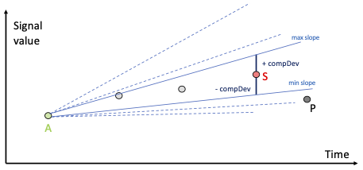
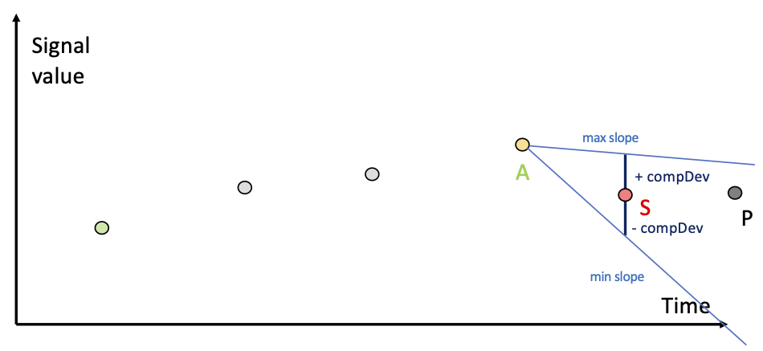

# Downsampler

The downsampler is a Benthos processor that discards messages which do not add information for a
time series: exact repeats, changes below a threshold, values inside a swinging-door envelope.
It keeps per-series state in memory, applies one of two algorithms to numeric values — deadband
(the default) or swinging door — and a change detector to boolean and string values.

The downsampler removes data by design and keeps all of its state in memory; see
[Delivery guarantees](#delivery-guarantees) for what that means for your pipeline. No setting
makes it lossless: even with `threshold: 0` and `late_policy: passthrough` it still drops exact
numeric repeats, every repeated boolean and string, and any message whose timestamp equals the
series' last processed timestamp.

## Why a value is missing

If a value you expected is not in your historian, one of the paths below dropped it.

1. **Threshold suppression.** The intended behaviour. Under deadband, a value within `threshold`
   of the last *emitted* value of the series; under swinging door, a value inside the current
   envelope. See [Deadband](#deadband) and [Swinging door](#swinging-door).
2. **Duplicate timestamp.** A message whose `timestamp_ms` equals the last processed timestamp of
   the series is dropped regardless of its value. This is the only cause logged above Debug
   level: Warn, greppable as `Dropping message with duplicate timestamp`.
3. **Boolean or string repeat.** A boolean or string identical to the last kept value of the same
   type for that series (see [Value types](#value-types)).
4. **`late_policy: drop`.** A numeric message older than the series' last timestamp is discarded on
   a deadband series; on a swinging-door series the late message instead replaces the held
   candidate (see [Late arrivals](#late-arrivals)).
5. **Swinging-door candidate discarded.** The most recent sample of a swinging-door series is held
   in memory as a candidate and is dropped — never emitted — when a newer sample supersedes it or
   when `max_time` fires. The test for this cause is to watch whether the series' next arrival
   produces it.
6. **Process restart or shutdown.** All state is in memory. A swinging-door candidate dies with
   the process, and the points collected at shutdown are not emitted
   (see [Delivery guarantees](#delivery-guarantees)).

Telling the causes apart from outside is limited. The counters are process-wide and cannot
attribute a drop to a series, and there is no per-series record of a dropped message. The
instrument that does work is the `downsampling_config` and `downsampled_by` metadata on the last
point that did reach the historian, which tells you the algorithm and parameters the series is
actually running (see [Output metadata](#output-metadata)). Threshold suppression, boolean and
string repeats, and late drops remain indistinguishable from one another.

## Why a suppressed value is emitted

These are the paths on which a value reaches your historian even though the configuration would
otherwise suppress it.

1. **First message of a series.** Always emitted. This includes the first message after a
   processor restart and the first after any state reset — for example after a per-message
   metadata hint changes the series' parameters (see
   [Metadata overrides](#metadata-overrides)).
2. **`max_time` reached.** The arriving message is emitted even if the algorithm would otherwise
   filter it (see [max_time](#max_time)).
3. **`late_policy: passthrough` (the default).** A message older than the series' last timestamp
   bypasses the algorithm entirely and is emitted unchanged.
4. **`ds_ignore` set.** Any non-empty value bypasses all downsampling logic.
5. **Fail-open error path.** Anything the processor cannot handle is forwarded, not dropped. This
   includes every message of a series whose configuration is invalid, for the lifetime of the
   process (see [Startup validation](#startup-validation)).
6. **Idle flush.** A swinging-door candidate held longer than the series' `max_time` — or 4 hours
   when `max_time` is unset — is released by the background timer and reaches the output with the
   next batch that passes through (see [max_time](#max_time)).
7. **Parameter-change flush.** When a per-message hint changes a series' parameters, a held
   candidate is flushed before the series' state is recreated
   (see [Metadata overrides](#metadata-overrides)).

## Which messages are downsampled

A message is downsampled only if **both** of the following hold:

- the metadata field `umh_topic` is present and non-empty;
- the payload is a JSON object with **exactly two keys**, `timestamp_ms` and `value`, where
  `timestamp_ms` is a number.

Anything else — a third key, a missing key, no `umh_topic`, a top-level array — is forwarded
unchanged and counted in `messages_passed_through`. Two malformed inputs instead take the error
path and raise `messages_errored` while still being forwarded unchanged: a `umh_topic` that is
present but **empty**, and a `timestamp_ms` that is present but **not a number**. The series key is
the `umh_topic` value; all state is per series.

The processor does **not** check `data_contract`. It downsamples whatever time series it is given,
whether the topic ends in `_historian`, `_raw`, or anything else.

## Value types

What happens to a message depends only on the Go type of its `value` field. The type is
dispatched before any threshold logic:

| `value` type | Handling | Suppressed when |
|---|---|---|
| number (integer or float) | configured algorithm (`deadband` or `swinging_door`) | see [Deadband](#deadband) / [Swinging door](#swinging-door) |
| boolean | change detector; thresholds are never consulted | identical to the last kept boolean for that series |
| string | change detector, exact byte comparison; `"42"` is never parsed as a number | identical to the last kept string for that series |
| `null`, object, array | error path: forwarded unchanged, counted in `messages_errored` | never |

Numeric, boolean and string state are three independent trackers per series. A tag that
alternates value types gets a fresh "first value" for each type, and each first value is emitted.
Boolean and string series get no `max_time` heartbeat, never consult `late_policy`, and are
suppressed on repeats alone — to keep every state change, mark the series
[`ds_ignore`](#metadata-overrides).

## Configuration

```yaml
pipeline:
  processors:
    - downsampler:
        default:                     # applies to every topic unless overridden
          late_policy: passthrough
          deadband:
            threshold: 0             # keep every change, drop exact repeats
            max_time: "30m"
        overrides:
          - pattern: "*.temperature"
            deadband:
              threshold: 0.1
          - pattern: "*.furnace*"
            late_policy: drop
            swinging_door:
              threshold: 0.5
              min_time: "5s"
              max_time: "1h"
        allow_meta_overrides: true   # honour per-message ds_* hints
```

`downsampler: {}` is valid: deadband, threshold 0, no heartbeat.

| Field | Type | Default | Notes |
|---|---|---|---|
| `default.deadband.threshold` | float | `0` | |
| `default.deadband.max_time` | duration string | unset (off) | no heartbeat for boolean and string series — see [max_time](#max_time) |
| `default.deadband.min_time` | duration string | — | **does nothing** — warning below |
| `default.swinging_door.threshold` | float | none | required unless inherited — see below |
| `default.swinging_door.max_time` / `.min_time` | duration string | unset (off) | `max_time` also drives the idle flush — see [max_time](#max_time) |
| `default.late_policy` | `passthrough` \| `drop` | `passthrough` | see [Late arrivals](#late-arrivals) |
| `overrides[].pattern` | glob string | required | |
| `overrides[]` | same algorithm fields and `late_policy` as `default` | | |
| `allow_meta_overrides` | bool | `true` | gates the `ds_*` hints — but **not** `ds_ignore` |

**`deadband.min_time` does nothing.** The field is accepted by the configuration schema and then
discarded by the parser; no code reads it. Set `min_time` only under `swinging_door`.

### Pattern matching

`pattern` uses shell-style globs (`filepath.Match`), not regular expressions. `*` matches any
sequence of characters, including dots, so `"*.temperature"` matches
`umh.v1.plant._historian.temperature`. `?` matches any single character, `[abc]` any character in
brackets.

Three traps:

- **First match wins.** Overrides are tried in order and the loop stops at the first match. An
  override that matches but sets no algorithm parameters still wins and shadows every later
  override for that topic.
- **The last topic segment is also tried.** A pattern that does not match the full topic is tried
  against the final dot-separated segment, so `pattern: "temperature"` matches
  `umh.v1.plant._historian.temperature`.
- **Empty and malformed patterns never match**, silently. `pattern: ""` and an invalid glob are
  skipped without a warning.

### Algorithm precedence

Precedence between the two algorithms is asymmetric:

- if `default` sets both `deadband` and `swinging_door`, **deadband** wins;
- if a single override sets both, **swinging door** wins.

Parameters carry across an algorithm switch. The effective parameters for a topic start from the
`default` block and an override only replaces what it names, so an override that switches a topic
to swinging door inherits the default deadband block's `max_time` (and any other parameter it does
not name), and vice versa. Check the `downsampling_config` output metadata (see
[Output metadata](#output-metadata)) to see the parameters a series actually runs with.

### Field types

A field with the wrong YAML kind — an object or array where a scalar belongs — is rejected at
startup. A scalar of the wrong type is not: `max_time: 30` and `threshold: "0.5"` both pass the
startup check and are then silently discarded, the value treated as unset. Write durations as
strings (`"30m"`, `"1h"`) and thresholds as numbers.

### Swinging door requires a threshold

`swinging_door.threshold` has no default: a swinging-door series fails to start unless a
threshold is in its effective parameters. A threshold set anywhere in those parameters satisfies
it — including one inherited from the `default` deadband block by an override or a `ds_algorithm`
hint that switches the algorithm (see [Algorithm precedence](#algorithm-precedence)). When no
threshold is in the effective parameters, the omission is not caught at startup; every message of
the affected series is forwarded unfiltered, forever — see
[Startup validation](#startup-validation).

## Deadband

Emit the first message of a series; afterwards emit a message when
`|value − last emitted value| ≥ threshold`. The comparison is inclusive: a change of exactly the
threshold is emitted. The reference is always the last **emitted** value, never the last seen
one, so drift accumulates against the last kept point rather than being re-zeroed by filtered
values.

`threshold: 0` (the default) is a special case: the comparison becomes strictly greater than
zero, so any non-zero change is emitted and exact repeats are dropped.

`threshold` is in the signal's own units. A defensible starting point is about twice the sensor's
noise standard deviation; where that is unknown, inspect a steady period of the raw data and use
the peak-to-peak spread.

Deadband never buffers. A filtered message is acknowledged upstream and discarded immediately;
an emitted message leaves in the same batch it arrived in, so deadband adds no latency. With
`max_time` set, see [max_time](#max_time).

## Swinging door

Swinging door bounds the reconstruction error of the whole series rather than the step between
points, so a long ramp keeps its shape with far fewer points, where deadband produces a staircase.
It holds each arriving sample as a *candidate* and decides about it only when the **next** sample
arrives. The consequences to know before choosing it:

- The point emitted at a door slam is the **previous** candidate, not the sample that triggered
  the emit, so a door-slam emission waits for the next sample to arrive. First messages, heartbeat
  emissions and idle-flush releases are emitted when they occur.
- `threshold` is mandatory — unless inherited through an algorithm switch (see
  [Swinging door requires a threshold](#swinging-door-requires-a-threshold)). It is the vertical
  error band, in the same units as the signal.
- When an arriving sample breaks the envelope, the previous candidate is emitted and **becomes
  the new anchor**; the arriving sample becomes the new candidate.
- `min_time` does not ignore arrivals. When an emit is due but the candidate is younger than
  `min_time`, the candidate is **replaced** by the arriving sample and nothing is emitted.
- A candidate superseded during normal operation is discarded, never emitted.
- When `max_time` fires, the pending candidate is discarded and the arriving message is emitted
  (see [max_time](#max_time)).

### Swinging door step by step

1. **Segment start (point A, green).**
   From the first sample in a segment the algorithm opens two straight "doors": an **upper** line
   and a **lower** line.
   *Their slopes mark the fastest rise and the slowest rise allowed while the signal stays inside
   the ± `threshold` error band.*
   

2. **Each new sample narrows the door.**
   Every arriving point recalculates the steepest and flattest slopes that would still stay within
   ± `threshold`. The cone can only shrink, so the blue lines pivot closer together frame by
   frame.

   

   

3. **Two working points — P and S.**

   * **P** (black) is the latest raw sample.
   * **S** (red, "snapshot") is the candidate the algorithm might emit.
     Unlike a deadband filter the algorithm does not decide about P immediately; first it tests
     whether S can still represent the trend after P tightens the cone.

4. **Door-slam event = keep S, start over.**
   The door slams when an arriving point's slope falls outside the current envelope, or when
   keeping S would put the straight line from the anchor to a later point more than `threshold`
   away from S's real value (see img 4 / final GIF frame). This happens earlier than a pure
   crossing of the two slope lines would suggest, so more points are kept than the pictures alone
   imply.

   * S is the last point that still satisfies the error band → the algorithm **emits S**.
   * S becomes the new anchor A of the next segment, the door re-opens to its full width, and P
     becomes the new candidate.

   

5. **Heartbeat and physics limits.**
   * `max_time` is checked when a message arrives. If it has expired, the arriving message is
     emitted and becomes the new anchor, and the pending candidate is discarded — it is not
     flushed.
   * When an emit is due but the candidate is younger than `min_time`, the candidate is replaced
     by the arriving sample and nothing is emitted.

6. **The GIF puts it together.**
   The blue cone lines swing, the red snapshot jumps forward whenever the door slams, and only a
   handful of black-× points survive.

   

Image source: [emrumo/swingingdoor](https://github.com/emrumo/swingingdoor)

Only door-slam emissions wait for the next arrival; first messages, heartbeats and idle-flush
releases are not delayed. Discrete counters, booleans and alarms belong on deadband, where every
kept value is emitted immediately.

## max_time

`max_time` bounds the gap between stored points — at `max_time` **plus up to one sampling
interval**, because both heartbeats compare with `>=`. What it does depends on the algorithm, and
the two cases differ.

### Deadband

The heartbeat is evaluated inside the algorithm when a message arrives; there is no timer. A
sensor that keeps sending — unchanged values, or values below `threshold` — emits its first
message, then one message every `max_time`. Each heartbeat is the arriving message itself,
carrying its own timestamp; there is no synthetic "repeat the last value" message.

A sensor that **stops sending emits nothing at all**, for any value of `max_time`, forever. A
dead sensor is indistinguishable from a flat one; a consumer that needs to detect gaps must do so
from the timestamps it receives.

### Swinging door

An arriving message whose timestamp is `max_time` past the last emit is emitted itself, the held
candidate is discarded, and the arriving message becomes the new anchor.

There is also a background wall-clock timer. Once a held candidate's stash age reaches the
series' `max_time` — or **4 hours when `max_time` is unset** — the timer releases the held message
and resets the series' algorithm. Three consequences:

- A dead swinging-door sensor's last suppressed sample does appear in the historian, roughly
  `max_time` (or 4 hours) after the silence began. It carries **no `downsampled_by` metadata**, so
  it looks like an ordinary sample.
- Because the flush resets the algorithm, the sensor's **next real sample is treated as a first
  message** and emitted unfiltered, whatever its value. A sensor that recovers with a large
  excursion writes that spike through.
- The flushed message reaches the output only when some later batch passes through the processor —
  it sits in the one-batch queue described under
  [Delivery guarantees](#delivery-guarantees).

Boolean and string series have no heartbeat at all: `max_time` is never consulted for them.

## Late arrivals

The `timestamp_ms` of each message is compared with the most recent timestamp already processed
for that series.

The policy applies only to numeric series. Booleans and strings are dispatched before the
late-arrival check, so a late *changed* boolean is emitted even under `drop`, and a late
*unchanged* one is dropped even under `passthrough`.

- `passthrough` (the default): a message older than the series' last timestamp bypasses the
  algorithm and is emitted unchanged. There is no marker on it — late messages are
  indistinguishable from in-order ones downstream.
- `drop`: a message older than the series' last timestamp is discarded on a deadband series. On a
  swinging-door series the late message is instead **stashed as the new candidate**, replacing
  and discarding whatever was held; the idle flush can later emit that stale message with its
  out-of-order value. The drop on a deadband series is logged at Debug level and counted in
  `messages_filtered`; there is no counter that separates it from threshold suppression.

Independently of the policy, a message whose `timestamp_ms` **equals** the series' last processed
timestamp is dropped regardless of its value (see
[Why a value is missing](#why-a-value-is-missing)).

## Metadata overrides

Instead of hard-coding every rule in the downsampler configuration, you can set downsampling
hints per message in metadata — typically in a preceding `tag_processor`. Hints apply per series;
a hint change flushes any held candidate and recreates the series' algorithm state, so the
message carrying the new hint is processed as the first message of a fresh series.

| Metadata key | Allowed values | Maps to |
|---|---|---|
| `ds_algorithm` | `"deadband"` \| `"swinging_door"` | algorithm choice |
| `ds_threshold` | float (negative values rejected) | `threshold` |
| `ds_min_time` | duration string (`"750ms"`, `"5s"`) | `min_time` |
| `ds_max_time` | duration string (`"15m"`, `"1h"`) | `max_time` |
| `ds_late_policy` | `"passthrough"` \| `"drop"` | `late_policy` |
| `ds_ignore` | any non-empty value | bypass downsampling entirely |

Precedence: per-message metadata → pattern override → `default`. A hint that is absent falls back
to the next level, so a message can override a single parameter.

`allow_meta_overrides` (default `true`) gates the five `ds_*` hints. It does **not** gate
`ds_ignore`, which is honoured regardless of the setting. An invalid hint — an unknown algorithm,
an unparseable number or duration, a policy outside the enum — is ignored with a warning and
counted in `meta_overrides_rejected`; the message is then processed with the configured settings.

### Bypassing a series with `ds_ignore`

Any message with a non-empty `ds_ignore` metadata value bypasses all downsampling logic. The
`ds_ignore` key is removed from the output message, `downsampled_by: "ignored"` is added, and the
message is counted in `messages_ignored`. Use it from the `tag_processor` for data that must reach
the historian unfiltered:

```yaml
pipeline:
  processors:
    - tag_processor:
        conditions:
          - if: msg.meta.tag_name === "emergency_stop" || msg.meta.tag_name.endsWith("_alarm")
            then: |
              msg.meta.ds_ignore = "true"
              return msg;
    - downsampler:
        default:
          deadband:
            threshold: 1.0
            max_time: "30m"
```

## Output metadata

Messages the downsampler emits carry:

- `downsampled_by` — `"deadband"`, `"swinging_door"` or `"ignored"`;
- `downsampling_config` — the parameters the series actually ran with, for example
  `deadband(threshold=0.500,max_time=30m0s)`.

Synthetic messages produced at shutdown or by a parameter-change flush additionally carry
`synthetic_flush_point: "true"` and `umh_topic`. An idle-flushed message is the raw stashed copy:
it carries neither key.

`ds_ignore` is deleted on the ignore path; other metadata is carried through unchanged.

`downsampled_by` is **absent** on non-time-series pass-through, on the fail-open error path, and
on candidates released by the idle flush or at shutdown. Downstream consumers cannot use its
presence as a marker for "this message went through the downsampler".

## Metrics

The processor exposes the counters `messages_processed`, `messages_filtered`,
`messages_errored`, `messages_passed_through`, `messages_ignored`,
`meta_overrides_applied`, `meta_overrides_rejected` and `meta_override_recreations`.

There is no dedicated counter for late drops: a message discarded by `late_policy: drop` — and
one dropped for a duplicate timestamp — is counted in `messages_filtered` and is
indistinguishable from threshold suppression in the metrics.

## Startup validation

The downsampler does not validate its configuration. Only three things are rejected before the
first message: a field with the wrong YAML kind, a `late_policy` outside `passthrough`/`drop`, and
an override without `pattern`. A scalar of the wrong type passes and is silently discarded
(see [Field types](#field-types)).

Everything else — a negative `threshold`, a `swinging_door` block without a threshold,
`min_time > max_time` — starts cleanly. The failure surfaces per series on the first message: the
algorithm cannot be constructed, the series is never registered, and from then on **every message
of that series is forwarded unfiltered**, for the lifetime of the process; topics whose own
configuration constructs cleanly keep downsampling. The operator sees one generic log line per
batch (`"Batch processing had %d errors, but continuing with fail-open policy"`) — the actual
reason is not logged — and a rising `messages_errored` counter.

To confirm a configuration runs, send test messages and check that `messages_errored` stays at
zero and that the `downsampling_config` metadata matches what you intended. A non-zero counter can
also mean inputs the processor cannot downsample — an empty `umh_topic`, a non-numeric
`timestamp_ms` — which are forwarded unchanged.

## Delivery guarantees

**Delivery and acknowledgement.** A suppressed message is acknowledged upstream as delivered and
then discarded; it cannot be recovered. Deadband does this immediately. Under swinging door a
sample is acknowledged at the moment it is stashed as a candidate, before the candidate is
emitted, so an acknowledged message can still be discarded later — when a newer sample supersedes
it or when `max_time` fires. At shutdown, the final points `Close()` collects are not emitted.

**State.** The processor keeps per-series algorithm state in memory: the last emitted value for
deadband, the anchor and current envelope for swinging door, and the last kept boolean or string
for the change detectors. Swinging door additionally holds one stashed candidate message per
series. None of this survives a restart; restarting resets every series, and the first message of
each series after a restart is treated as a first message (see
[Why a suppressed value is emitted](#why-a-suppressed-value-is-emitted)).

**Time.** All algorithm decisions use the message's `timestamp_ms`, never the wall clock — which
is why the deadband heartbeat takes effect only when a message arrives. A message whose timestamp
equals the series' last processed timestamp is dropped regardless of its value. Older timestamps
are governed by `late_policy` (see [Late arrivals](#late-arrivals)). The only wall-clock use is
the swinging-door idle flush (see [max_time](#max_time)).

**Errors.** There is no retry and no dead-letter queue. The processor is fail-open: anything it
cannot handle is forwarded unchanged and counted in `messages_errored`. It never returns an
error to Benthos, so it never blocks the pipeline. The visible symptom of an invalid
configuration is a rising `messages_errored` counter while the affected series passes through
unfiltered (see [Startup validation](#startup-validation)).

**Limits.** These guarantees hold only while the process stays alive and messages keep arriving:
nothing is persisted, and the idle and shutdown flushes write into a one-batch queue that only
the regular processing loop reads, so their output reaches the pipeline only if another batch
arrives afterwards. The downsampler is not suited for pipelines where every sample must be
preserved: it removes data by design, holds each swinging-door series' unemitted candidate in
memory, and cannot reconstruct either. If a consumer needs the full raw stream, archive the
unfiltered topic in parallel.
